

# Gateway Lite 

Installation Manual

Updated 4 November 2026

Gateway Lite

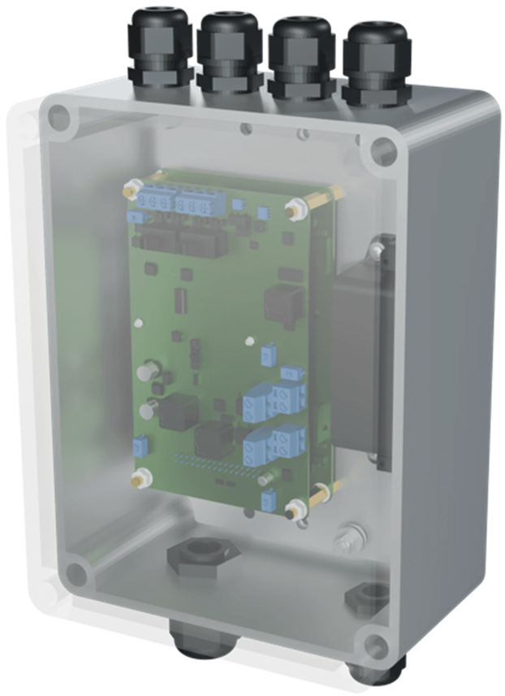

**Conditions of Use**

- Please read this manual completely before working on, or making adjustments to the Compac Gateway Lite 
- Compac Industries Limited accepts no liability for personal injury or property damage resulting from working on or adjusting the equipment incorrectly or without authorization.  
- Along with any warnings, instructions, and procedures in this manual, you should also observe any other common sense procedures that are generally applicable to equipment of this type. 
- Failure to comply with any warnings, instructions, procedures, or any other common sense procedures may result in injury, equipment damage, property damage, or poor performance of the Compac equipment 
- The major hazard involved with operating the Compac C5K processor is electrical shock. This hazard can be avoided if you adhere to the procedures in this manual and exercise all due care. 
- Compac Industries Limited accepts no liability for direct, indirect, incidental, special, or consequential damages resulting from failure to follow any warnings, instructions, and procedures in this manual, or any other common sense procedures generally applicable to equipment of this type. The foregoing limitation extends to damages to person or property caused by the Compac C5K processor, or damages resulting from the inability to use the Compac C5K processor, including loss of profits, loss of products, loss of power supply, the cost of arranging an alternative power supply, and loss of time, whether incurred by the user or their employees, the installer, the commissioner, a service technician, or any third party.  
- Compac Industries Limited reserves the right to change the specifications of its products or the information in this manual without necessarily notifying its users. 
- Variations in installation and operating conditions may affect the Compac C5K processor's performance. Compac Industries Limited has no control over each installation's unique operating environment. Hence, Compac Industries Limited makes no representations or warranties concerning the performance of the Compac C5K processor under the actual operating conditions prevailing at the installation. A technical expert of your choosing should validate all operating parameters for each application. 
- Compac Industries Limited has made every effort to explain all servicing procedures, warnings, and safety precautions as clearly and completely as possible. However, due to the range of operating environments, it is not possible to anticipate every issue that may arise. This manual is intended to provide general guidance. For specific guidance and technical support, contact your authorised Compac supplier, using the contact details in the Product Identification section.
- Only parts supplied by or approved by Compac may be used and no unauthorised modifications to the hardware of software may be made. The use of non-approved parts or modifications will void all warranties and approvals. The use of non-approved parts or modifications may also constitute a safety hazard.
- Information in this manual shall not be deemed a warranty, representation, or guarantee. For warranty provisions applicable to the Compac C5K processor, please refer to the warranty provided by the supplier.
- Unless otherwise noted, references to brand names, product names, or trademarks constitute the intellectual property of the owner thereof. Subject to your right to use the Compac C5K processor, Compac does not convey any right, title, or interest in its intellectual property, including and without limitation, its patents, copyrights, and know-how. 
- Every effort has been made to ensure the accuracy of this document. However, it may contain technical inaccuracies or typographical errors. Compac Industries Limited assumes no responsibility for and disclaims all liability of such inaccuracies, errors, or omissions in this publication.

**Validity**

This manual covers the following Compac products
- Gateway Lite

Compac Industries Limited reserves the right to revise or change product specifications at any time. 
This publication describes the state of the product at the time of publication and may not reflect the product at all times in the past or in the future.

**Manufactured by:** 
The Gateway Lite is designed and manufactured by Compac Industries Limited 
52 Walls Road, Penrose, Auckland 1061, New Zealand 
P.O. Box 12-417, Penrose, Auckland 1641, New Zealand 
Phone: + 64 9 579 2094 
Fax: + 64 9 579 0635 
Email: techsupport@compac.co.nz 
www.compac.co.nz 
Copyright ©2015 Compac Industries Limited, All Rights Reserved
 
 

# Table of Contents

[**Safety**](#safety)

[**Introduction to the Gateway Lite**](#introduction-to-the-gateway-lite)

[Standalone mode](#standalone-mode)

[Listening mode](#listening-mode) 

[Remote Authorisation mode](#remote-authorisation-mode) 

[Tank Gauging](#tank-gauging)

[**Gateway Lite technical drawings**](#gateway-lite-technical-drawings)

[Dimensions](#dimensions)

[Wall mounting](#wall-mounting)

[Glands](#glands)

[Electronics module](#electronics-module)

[**Pre-installation**](#pre-installation)

[Zone requirements and Electrical Approvals](#zone-requirements-and-electrical-approvals)

[Tools](#tools)

[**Installation**](#installation)

[**Mechanical Installation**](#mechanical-installation)

[Mounting](#)

[Glanding](#glanding)

[**Electrical Installation**](#electrical-installation)

[230V Mains connection](#230v-mains-connection)

[Internet connection](#internet-connection) 

[Pump setup](#pump-setup)

[**CI533 C5K Comms Driver connections**](#ci533-c5k-comms-driver-connections)

[CI533 COMMS board functions](#ci533-comms-board-functions)

[CI533 COMMS channels](#ci533-comms-channels)

[CI533 Comms board Dipswitch settings](#ci533-comms-board-dipswitch-settings)

[**Compac** Comms](#compac-comms)

[**Gilbarco** Comms](#gilbarco-comms)

[**Dart** Comms](#dart-comms)

[4-20 mA Tank Probe connection](#4-20-ma-tank-probe-connection)

[**Servicing**](#servicing)

[**Maintenance**](#maintenance)

[**LED diagnostics**](#led-diagnostics)

[C5K Processor Board](#c5k-processor-board)

[CI533 Comms interface board](#ci533-comms-interface-board)

[**Troubleshooting**](#)

[**Spare Parts**](#spare-parts)

[**Modem Diagnostic LEDs**](#modem-diagnostic-leds)

# Safety

Please adhere to the following safety precautions at all times when working on the Compac Gateway Lite. 
Failure to observe these safety precautions could result in damage to the Compac Gateway Lite, injury, or death. 
Ensure that you read and understand all safety precautions before installing, servicing or operating the Compac Gateway.

**PRECAUTIONS**

Always follow safe operating procedures, any national or local regulations and site specific instructions. 

Make sure that the service area is thoroughly clean when servicing. Dust and dirt entering the components reduce the life span of the components and can affect operation. 

**Site Safety**

Comply with all safe site regulations for the site you are working on and any additional instructions from the site manager. 

Wear and use appropriate safety equipment such as safety boots, high visibility clothing, hard hat, gloves and barrier cream. 

Cordon off the area you are working in using cones, barriers, caution tape etc.

**CAUTION** 

When working near any flammable goods area, take all precautions to avoid all potential sources of ignition. This includes but is not limited to: Open flames, hot exhausts, welding flames or sparks, static electricity, non-intrinsically safe electrical equipment, use of mobile phones. 

These instructions are to be used as a guide only and may not cover all situations. It is the responsibility of yourself and the site manager to take appropriate health and safety precautions. 

**Electrical Safety**

**CAUTION** 

Always turn off the power to the Compac Gateway Lite before removing the lid. 
Never touch wiring or components inside the high voltage area with the power on. 

Always turn off the power to the Compac Gateway Lite before installing or replacing any components . 

Always take basic anti-static precautions when working on the electronics, i.e., wearing a wristband with an earth strap.

**240 Volts** 

The Compac Gateway is powered by 240 Volt AC mains power. The mains power enters the cabinet via a gland in the box and is connected to the power supply. The power supply steps down the 240 Volts AC to 12 volt DC to power the main electronic components.

 

# Introduction to the Gateway Lite

The Gateway Lite can be operated in any of the following modes.

# Standalone mode
- The Dispensers on the site are connected to the pump comms on the Gateway Lite 
- The Dispensers are configured to be in standalone mode so do not require authorization to start a fill.  
  The Customer or Operator just lifts the nozzle and dispenses fuel 
- The Gateway Lite records the transaction and sends the transaction records up to cloud based CompacOnline     

# Listening mode 
- The Dispensers on the site are connected to another Point of Sale or Site Controller which authorizes them 
- The comms channel of the Gateway Lite is connected in parallel with the Pump comms to the Dispensers 
- The Gateway Lite listens to the transactions on the pump comms, records them and sends the transaction records up to cloud based CompacOnline 

# Remote Authorisation mode 
- The Dispensers on the site are connected to the pump comms on the Gateway Lite 
- They work in controller mode so require authorization to allow a fill to start.  
- The Dispensers are authorized from CompacOnline using the Compac Refuel App or other device via the CompacOnline API.  
- The Gateway Lite records the transaction and sends the transacion records up to cloud based CompacOnline     

# Tank Gauging

There are Tank Gauging inputs for 4-20mA Tank Probes on the Gateway Lite (up to a maximum of two tank probes) 
This gives visibility of fuel levels in the tanks on CompacOnline.

On CompacOnline, there is the ability to reconcile tank fuel inventory against the transaction amounts.

 

# Gateway Lite technical drawings

 

# Dimensions

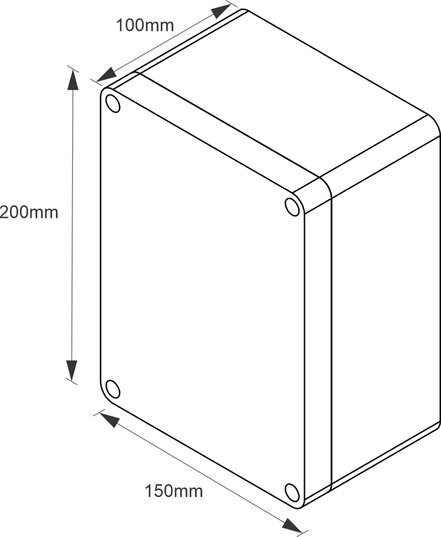

 

# Wall mounting

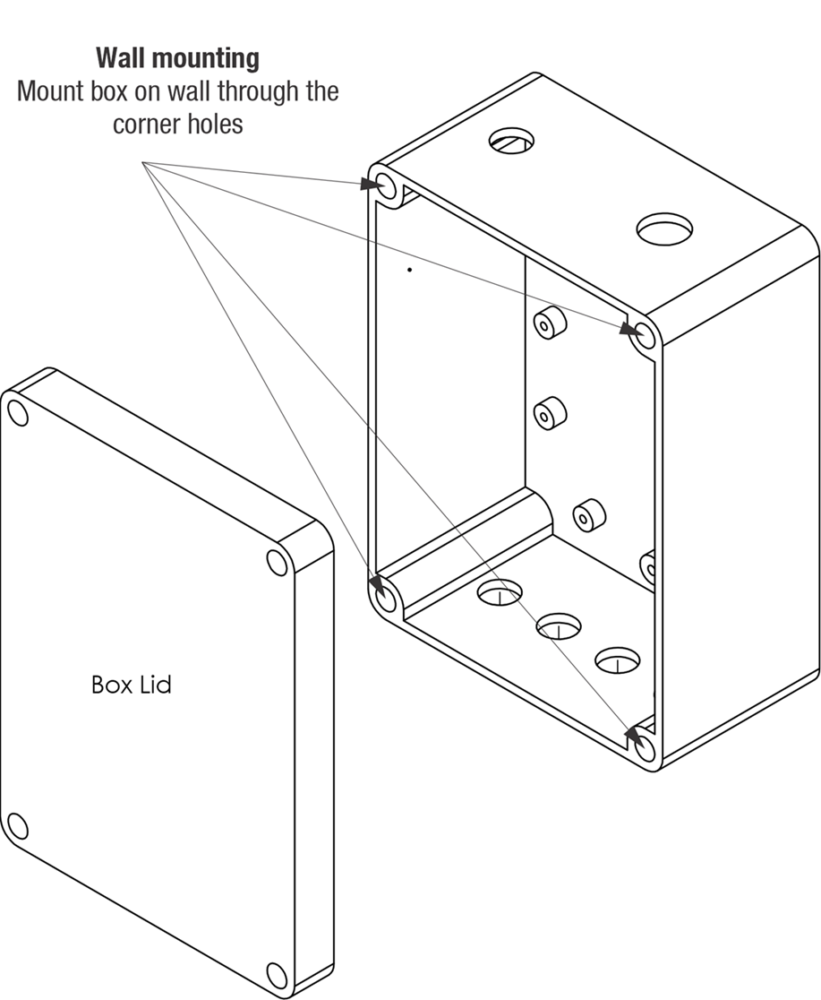

 

# Glands

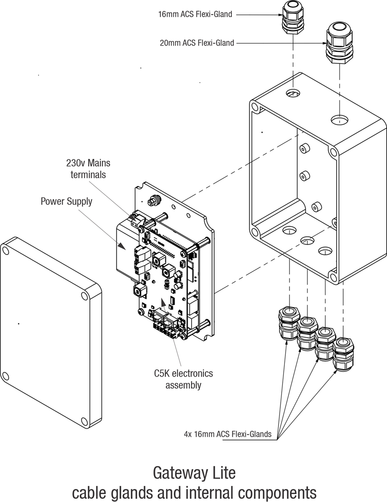

 

# Electronics module
 
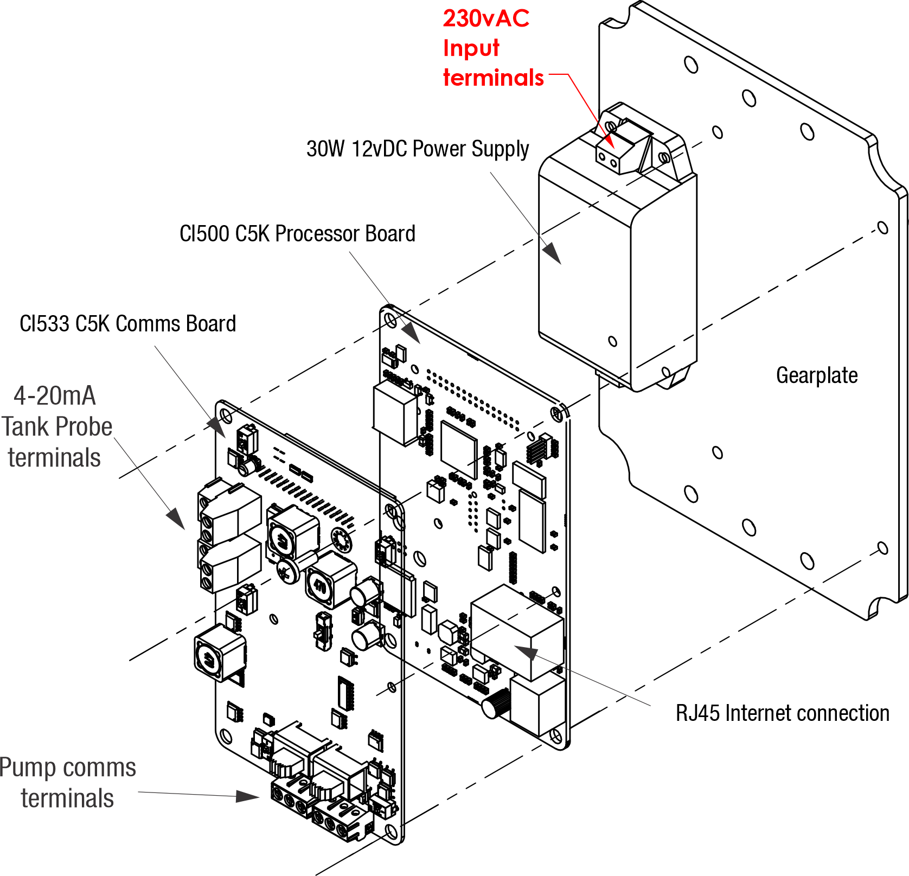
 

 

# Pre-installation

# Zone requirements and Electrical Approvals

**Electrical Approvals**

**NOTE: 
the Compac Gateway Lite is NOT approved for installation in a hazardous area.** 
Please consult the site's zone drawings to find the exact positions of the hazardous areas for the particular site. 

# Tools

Having all the correct tools will make installation, upgrade and repair procedures easy and minimise the risk of damage to components.
Before you arrive on site, make sure you have a minimum of all the tools listed here.

- 5.5mm nut driver
- 7mm nut driver
- 8mm nut driver
- T30 Torx drive bit or driver
- T10 Torx drive bit or driver
- Metric spanner set
- Metric 3/8" or 1/4" drive socket set
- 1/4" screwdriver bit holder
- 1/4" A/F spanner
- 6" adjustable spanner
- Flat blade screwdriver set (1.5 - 5mm blades)
- #0, #1, #2 Phillips screwdrivers
- #1, #2 Pozidriv screwdrivers
- Set of metric Allen (hex) keys
- Fine long nose pliers, side cutters & pliers
- Hacksaw
- Stanley knife or similar sharp blade
- Ruler
- Multimeter
- Laptop or smartphone with internet

# Installation

# Mechanical Installation

# Mounting
If the Gateway Lite needs to be wall mounted, fix through the corners holes (same holes as the lid screws into) to avoid compromising the integrity of the box. 

# Glanding

16 and 20mm flexi-glands are provided with the Gateway Lite

Any unused gland access holes should be blanked with grommets.

 

# Electrical Installation 

Scope of Electrical installation of the Gateway Lite is as follows:

1. Connect the 240V Mains 

2. Connect the Pump Comms 

3. Connect the Router 

4. Connect the Tank Probes (if part of the installation)

5. Setup the Gateway Lite on CompacOnline

 

# 230V Mains connection

Connect the 230V incoming Mains to the terminals on the Power Supply

# Internet connection 

Plug the ethernet cable from the router into the RJ45 connector on the CI500 C5K Processor board

**Notes:**
1. The Gateway Lite is designed to work with Comset CM685V-4 and Teltonika RUT241 Routers

2. If the IP address needs to be changed in the Gateway Lite, this must be carried out on CompacOnline

 

# Pump setup

The Pump setup must be carried out on CompacOnline. There is no provision to do this on the Gateway Lite.

The Dispensers may have already been set up in the Gateway Lite during provisioning of the unit during manufacture at the Compac Factory so it may not be necessary to do this as part of the installation.

If not set up, this must be done from CompacOnline

Please refer to the CompacOnline V2 User Manual. This manual is available on the Compac website in the Documentation section of the CompacOnline Fluid Management Product page
Pumps and Tanks are set up in the Sites section of the manual  

 

# CI533 C5K Comms Driver connections

In the Gateway Lite, the CI533 Comms interface PCB board is piggy-backed on top of the Processor Board. 
All comms site connections are made directly onto the CI533 Comms Board.

# CI533 COMMS board functions 

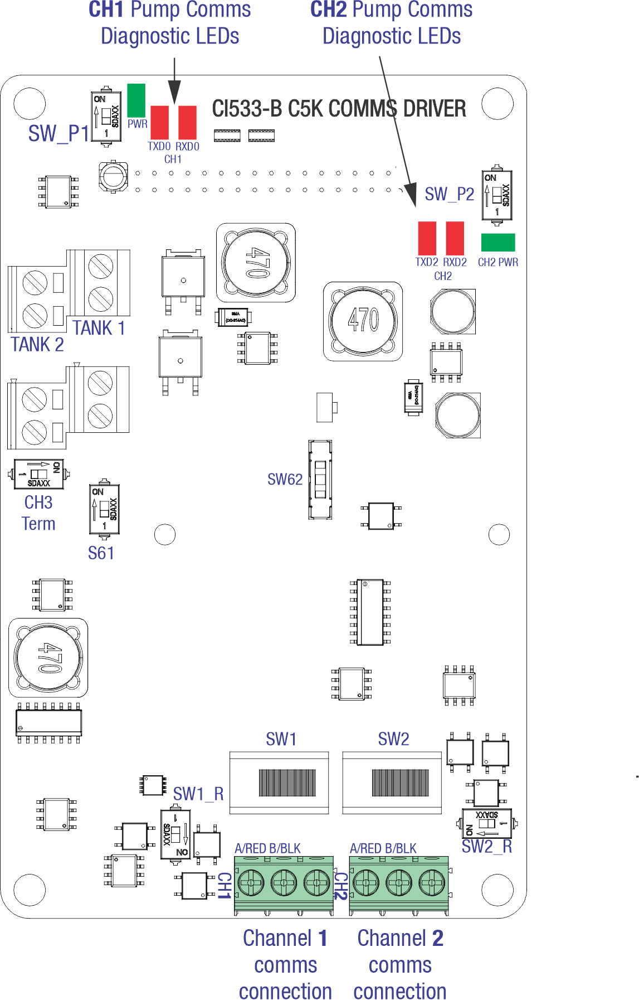 

The CI533 Comms board has two functions. 
1.	Enables the Gateway LITE to communicate with the following makes of Pumps and Dispensers
- Compac
- Gilbarco
- Wayne

2.	It has a Tank-gauging interface to connect to 2x 4-20mA Tank Probes 

 

# CI533 COMMS channels 
There are three Comms channels

**Channel 1.** CH1 can be configured for the following protocol options using Switch SW1 
•	COMPAC standard current loop comms  
•	COMPAC Comms over RS485 
•	Wayne DART protocol over RS485 
 
If Compac Comms over RS485 for long distances is required (ie greater than 100 metres), set CH1 to RS485 and configure CH1 for Compac on CompacOnline

For Wayne DART protocol, configure CH1 for RS485 and configure CH1 on CompacOnline Wayne DART protocol

There is an ENABLE switch SW_P1 to turn CH1 ON. A Green LED indicates that the CH1 is ON 
When communicating with a Pump or Dispenser, the Tx and Rx red LEDS will flash 
SW_P1 is normally left in the ON position

**Channel 2** CH2 can be configured for the following protocol options using Switch SW2 
•	COMPAC protocol over RS485 
•	GILBARCO protocol 
•	Wayne DART protocol over RS485  

If Compac Comms over RS485 for long distances is required (ie greater than 100 metres, set CH2 to RS485 and configure CH2 for Compac on CompacOnline. 

For Wayne DART protocol, configure CH2 for RS485 and configure CH2 in  Local setup / Pumps / Comms for Wayne DART protocol

There is an ENABLE switch SW_P2 to turn CH2 ON. A Green LED indicates that the CH2 is ON 
When communicating with a Pump or Dispenser, the Tx and Rx red LEDS will flash 
SW_P2 is normally left in the ON position

**Channel 3** CH3 can be configured for either RS232 or RS485 using Switch S61
CH3 is currently not used in the Gateway Lite  

 

# CI533 Comms board Dipswitch settings

|Switch|Function|Setting|Application|
|------|--------|-------|--------|
|SW1|CH1 channel 1|1|Compac (standard Current Loop)comms
|   |             |2|RS485
|SW2|CH2 channel 2|1|Gilbarco  
|   |             |2|RS485
|S61|CH3 Channel 3 selector switch|ON|RS232
|   |                             |OFF|RS485
|SW62|Current (mA)|45|Wayne
|    |            |30|Gilbarco AUS
|    |            |20|Gilbarco USA

**Notes**
1. **SW62** - This switch is used for current loop systems on channel 1 (e.g. Gilbarco, Wayne). 
Adjust the switch according to the current (mA) of the site protocol as required. There are three current options.

2. **CH3 Term, SW1_R and SW2_R** 
These switches are used for an end of line termination resistor for RS485 applications. 
They are not currently supported and should be left in the OFF position 

 

# Compac Comms

The following are the connections and switch setting for Compac/PEC on the CI533A. 
Note that Channel 2 is free to be used as either Gilbarco or Dart

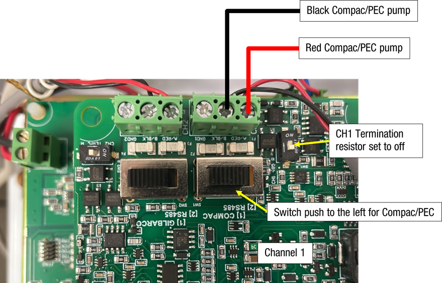 
Also you need to ensure that the Channel that you are using is switched on. 
When the channel is enabled, the green LED indicator will be on.

 

# Gilbarco Comms

The following are the connections and switch settings for Gilbarco on the CI533A. 
Note that Channel 1 is free to be used as Compac or Dart

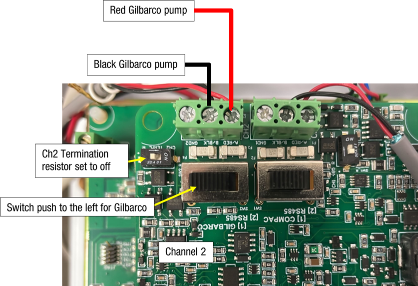 
Also you need to ensure that the Channel that you are using is switched on. 
When the channel is enabled, the green LED indicator will be on.
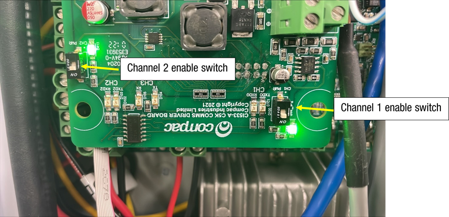

 

# Dart Comms

The following are the connections and switch settings for Dart on the CI533A Ch1 and Ch2 

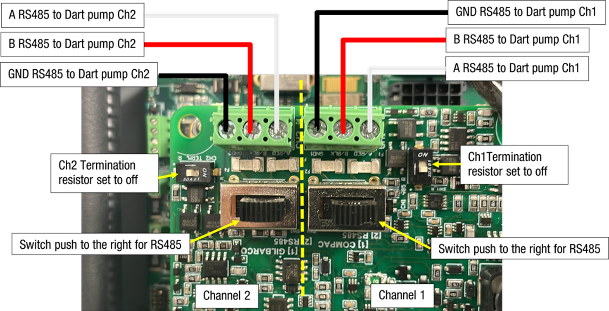
Also you need to ensure that the Channel that you are using is switched on. 
When the channel is enabled, the green LED indicator will be on.
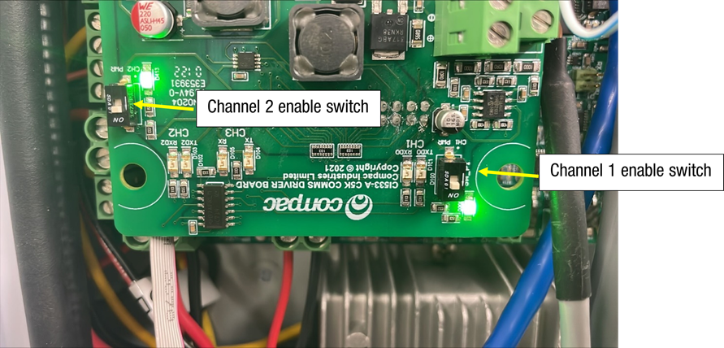

 

# 4-20 mA Tank Probe connection

Connect the cables from the 4-20mA Tank Probes to the CI533 Comms board as shown

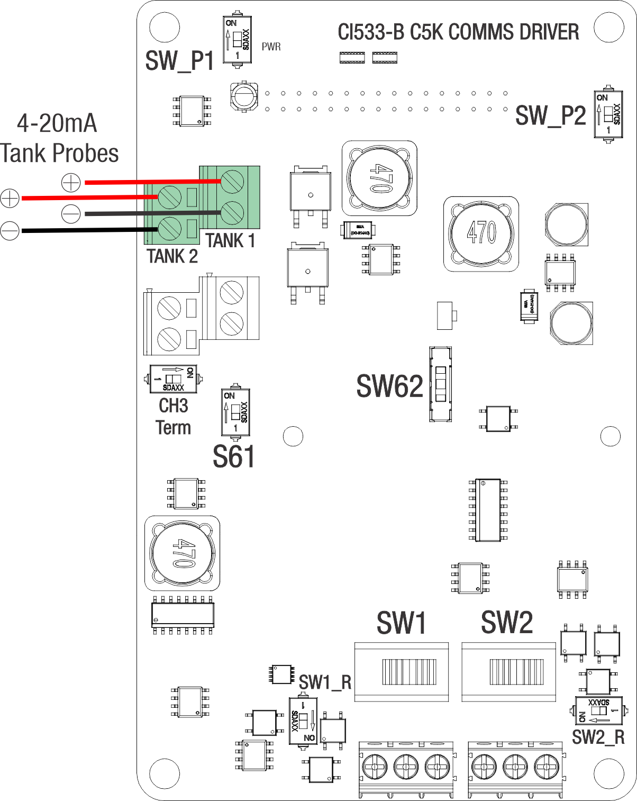

 

# Servicing

Having all the correct tools will make installation, upgrade and repair procedures easy and minimise the risk of damage to components. 

Before you arrive on site, make sure you have a minimum of all the tools listed here.

- 5.5mm nut driver
- 7mm nut driver
- 8mm nut driver
- T30 Torx drive bit or driver
- T10 Torx drive bit or driver
- Metric spanner set
- Metric 3/8" or 1/4" drive socket set
- 1/4" screwdriver bit holder
- 1/4" A/F spanner
- 6" adjustable spanner
- Flat blade screwdriver set (1.5 - 5mm blades)
- #0, #1, #2 Phillips screwdrivers
- #1, #2 Pozidriv screwdrivers
- Set of metric Allen (hex) keys
- Fine long nose pliers, side cutters & pliers
- Hacksaw
- Stanley knife or similar sharp blade
- Ruler
- Multimeter
- Laptop or smartphone with internet

 

# Maintenance

The Gateway is a relatively simple unit with no moving parts and therefore needs minimal maintenance. 

 

# LED diagnostics

To assist in diagnosing faults, there are diagnostic LEDs on both the C5K Processor Board and Comms interface board as follows

# C5K Processor Board

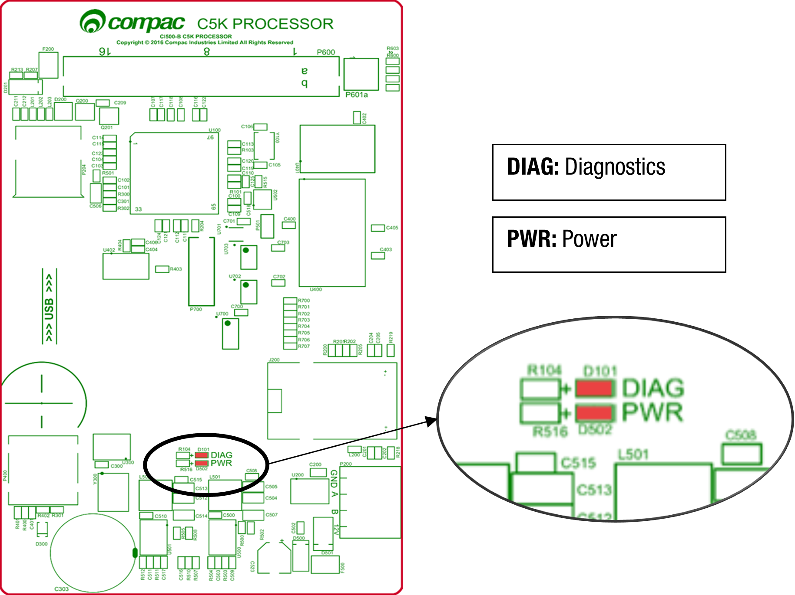

Processor board LEDs       |Operation/Possible Cause| 
|-----------------------------|------------------------|
**Power**|This should be on when there is power to the unit.
**Diagnostics**| This LED shows whether the firmware is running for the board. If it is off, the firmware is not running, and if it is on, the firmware is running.   Upon start up this LED will flash, indicating that the firmware is loading.   The flashing may last up to a minute before it stabilises to being constantly on.   If the flashing lasts longer, the board is in bootloader mode – this means that the firmware has crashed or not loaded correctly.

 

# CI533 Comms interface board 

There are diagnostic LEDs on the CI533 Comms Board for both Channel 1 and Channel 2 

**Notes:**
1. The Tx and Rx LEDS will only work when the Channel is enabled (Green LED is ON) 
2. If only one Red LED is flashing, the Gateway is polling the pump but the pump is not replying 
Check comms wiring and Pump setup

|CI533 Comms board LEDs|Colour|Status|Description|
|----------------------|------|------|-----------|
|CH1 PWR               |Green |ON    |Comms channel 1 is enabled when this LED is ON|
|TXD0                  |Red   |Flashes|Flashes alternately with RXD0    
|RXD0                  |Red   |Flashes|Flashes alternately with TXD0
|CH2 PWR               |Green |ON    |Comms channel 2 is enabled when this LED is ON|
|TXD2                  |Red   |Flashes|Flashes alternately with RXD2    
|RXD2                  |Red   |Flashes|Flashes alternately with TXD2

 

 

# Troubleshooting

|Problem|Possible cause|Recommended action|
|-------|---------------|------------------|
|No Power/No Lights|No power entering  unit|Ensure that power is entering unit, check external fuses and switches
|Pumps will not dispense fuel|Wrong pump number set|Ensure pump number set in pumps matches pump number set in controller and also pump number written on the pump.
|                            |No fuel in tanks|Verify tanks have sufficient product 
|                            |                |Try another pump to verify. Contact pump service agent 
|                            |Pump fault	  |Have service agent check pumps
|Pump not communicating with the Gateway|Comms issue|Check operation of the Tx an Rx diagnostic LEDS on poth the pump and the CI533 Comms Board in the Gateway.
|                                       |Pump software issue|Ensure that the pump has the correct software version. 
		
 

# Spare Parts

Spare parts for the Gateway Lite are as follows: 

|Part Description|Compac part number|
|----------------|------------------|
|Power Supply|F-BA-PWR-IRM3012|
|CI500 C5K Processor board|F-CP-C5K-PROCES
|CI533 Comms interface board|F-CP-C5K-CGIL485|
|SD card|F-BA-MICROSD32GB|

 

# Modem Diagnostic LEDs

Comset and Teltonika routers are currently supported. 
The LEDs can be used to diagnose problems with the routers.

# COMSET Router 

The LEDs of the Comset Router are as follows.

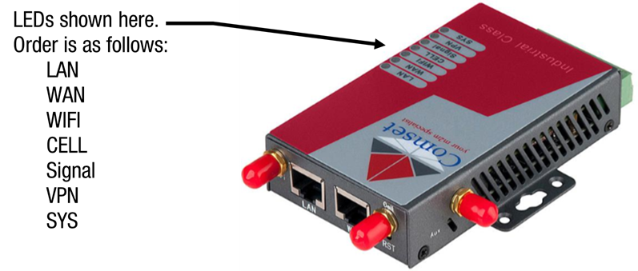

Refer to the accompanying table to understand the modem LEDs.

LED| Indication Light| Description
|-----|-----|-----|
|SYS| On for 25 seconds| On for 25 seconds after power up
| |Blinking| System set-up normally
| |Off or still on after 25 seconds|	System set-up failure
| | | |
LAN| Blinking| Ethernet data transmission
| |Off|	No Ethernet connection
| |On|Ethernet is connected
| | | |
VPN| On|	VPN tunnel set-up
| | Off|	VPN tunnel not set-up or VPN failure
| | | |
CELL| On|	Cell connection is ‘UP’ and now you have access to the Internet
| | | |
WIFI| On|	WiFi enabled
| | Off|	WiFi disabled
| | Blinking| Ethernet data transmission
| | | |
WAN| Off|	No Ethernet connection
| |On| Ethernet is connected
| | | |
Signal|	Off| No signal, or signal checking is not ready
| | Blinks once every 4s|	Signal bar is 1
| | Blinks once every 3s|	Signal bar is 2
| | Blinks once every 2s|	Signal bar is 3
| | Blinks once every 1s|	Signal bar is 4
| | Blinks twice every1s|	Signal bar is 5
| | 

 

# TELTONIKA RUT241 Router

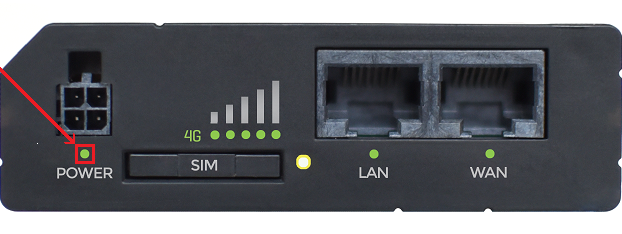 

**Power LED**. The **power LED** is located on the bottom left corner of the front panel, just under the power connector:

**Ethernet port LEDs**. The **Ethernet port LEDs** are located on the router's front panel, under each respective Ethernet port:

**Connection status LEDs**. The **connection status LEDs** are located on the left side of the front panel, between the power connector and the signal strength indication LEDs:

**Signal strength LEDs**. The signal strength LEDs are located in the center of the front panel, to the right of the connection status LEDs:

|LED|Action|Description|
|---|------|-----------|
|POWER|ON|Router is powered up
|     |OFF|Router is not powered up
|Ethernet port LEDs|ON|Operating as a 10/100 Mbps connection|
|                  |OFF|No link established|
|                  |LEDs light up and turn OFF in sequence from WAN port to LAN1 port|The router is in the bootloader menu state|
|Connection status LEDs|2G, 3G and 4G LEDs blinking every 1 second|No SIM or bad PIN|
|                      |Blinking from 2G LED to 4G LED repeatedly|Attempting to connect to a mobile network operator
|                      |2G/3G/4G LED blinking every 1 sec|Connected to 2G/3G/4G, no data session established|
|                      |2G/3G/4G LED turned on|	Connected to 2G/3G/4G with data session|
|                      |2G/3G/4G LED blinking rapidly|	Connected to 2G/3G/4G with data session and data is being transferred

|Signal strength LEDs|No of Lit up LEDs|Signal strength value|
|--------------------|-----------------|---------------------|
|                    |0|≤ -111 dBm|
|                    |1|-110 dBm to -97 dBm|
|                    |2|-96 dBm to -82 dBm|
|                    |3|-81 dBm to -67 dBm|
|                    |4|-66 dBm to -52 dBm|
|                    |5|≥ -51 dBm|

The signal strength LEDs can also be used as a **time indicator for holding the reset button.** 
When you press and hold the reset button, if there is a User's default configuration configured on the device, you have to hold it pressed for 6 seconds (by default) to initiate a **User's default** configuration reset and 12 seconds (by default) to initiate a **Factory reset.** 
Otherwise, it is only necessary to hold the reset button for 6 seconds to trigger a Factory reset. 
If the button was held down longer than 20 seconds (by default) no action will be taken.

While holding the reset button each lit up signal strength LED indicate that a period of two seconds has passed. 
When all 5 signal strength LEDs are lit up, they represent that 10 (LED number multiplied by 2) seconds have passed since you pressed down on the reset button.

After releasing the button at one of the reset periods, all 5 LEDs will start blinking every 1 second. This signifies that the router **has begun the reset.**

After the router gets powered up, all signal strength LEDs will turn ON and stay ON for about 40 seconds or until the router's modem registers on a network - after this, the LEDs will start displaying the router's current signal strength

 

