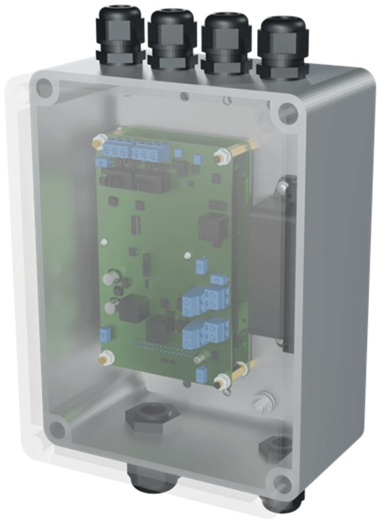
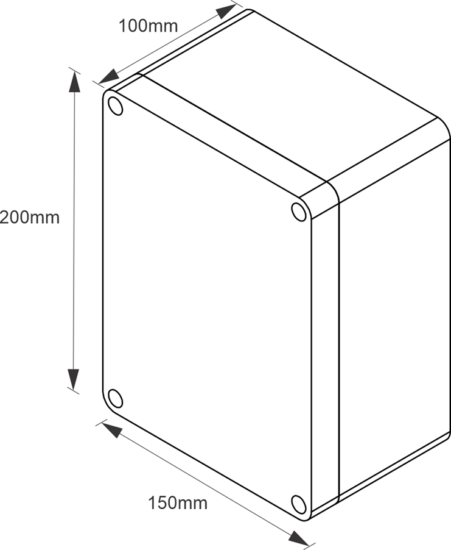
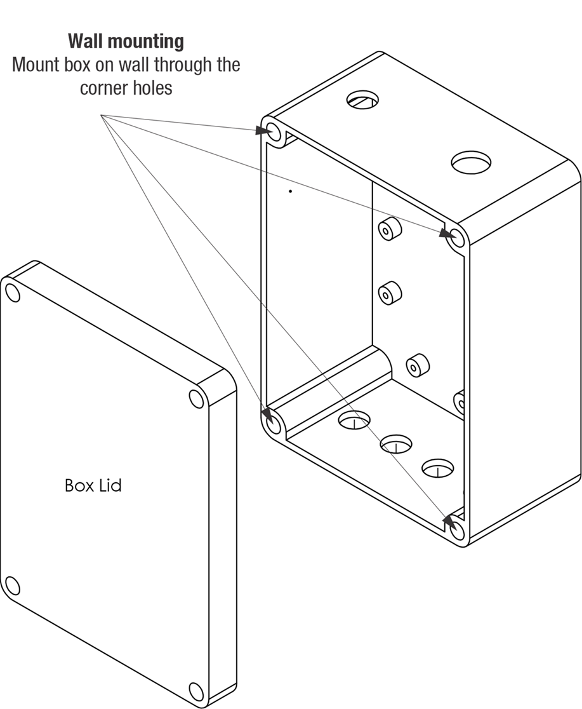
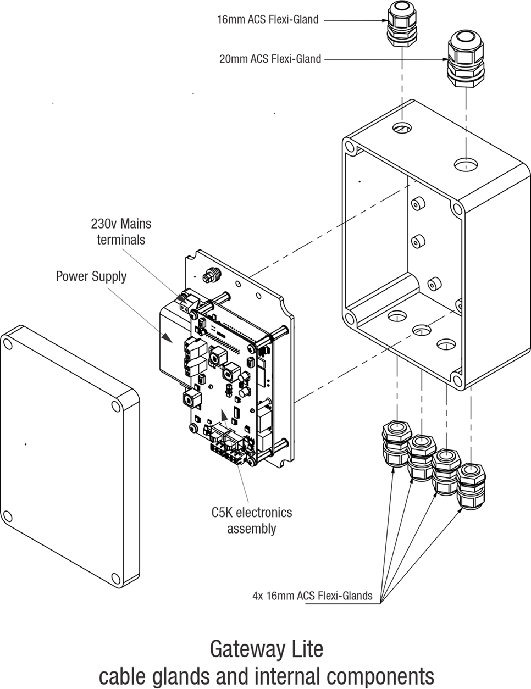
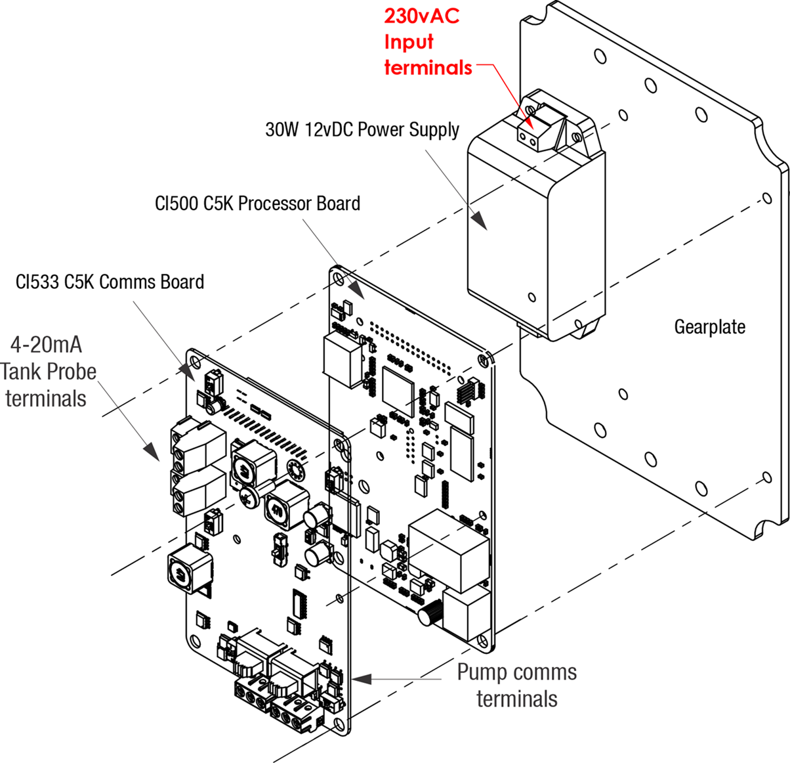

# Gateway Lite 

Installation Manual

Updated 28 October 2026

Gateway Lite

**Conditions of Use**

- Please read this manual completely before working on, or making adjustments to the Compac Gateway Lite 
- Compac Industries Limited accepts no liability for personal injury or property damage resulting from working on or adjusting the equipment incorrectly or without authorization.  
- Along with any warnings, instructions, and procedures in this manual, you should also observe any other common sense procedures that are generally applicable to equipment of this type. 
- Failure to comply with any warnings, instructions, procedures, or any other common sense procedures may result in injury, equipment damage, property damage, or poor performance of the Compac equipment 
- The major hazard involved with operating the Compac C5K processor is electrical shock. This hazard can be avoided if you adhere to the procedures in this manual and exercise all due care. 
- Compac Industries Limited accepts no liability for direct, indirect, incidental, special, or consequential damages resulting from failure to follow any warnings, instructions, and procedures in this manual, or any other common sense procedures generally applicable to equipment of this type. The foregoing limitation extends to damages to person or property caused by the Compac C5K processor, or damages resulting from the inability to use the Compac C5K processor, including loss of profits, loss of products, loss of power supply, the cost of arranging an alternative power supply, and loss of time, whether incurred by the user or their employees, the installer, the commissioner, a service technician, or any third party.  
- Compac Industries Limited reserves the right to change the specifications of its products or the information in this manual without necessarily notifying its users. 
- Variations in installation and operating conditions may affect the Compac C5K processor's performance. Compac Industries Limited has no control over each installation's unique operating environment. Hence, Compac Industries Limited makes no representations or warranties concerning the performance of the Compac C5K processor under the actual operating conditions prevailing at the installation. A technical expert of your choosing should validate all operating parameters for each application. 
- Compac Industries Limited has made every effort to explain all servicing procedures, warnings, and safety precautions as clearly and completely as possible. However, due to the range of operating environments, it is not possible to anticipate every issue that may arise. This manual is intended to provide general guidance. For specific guidance and technical support, contact your authorised Compac supplier, using the contact details in the Product Identification section.
- Only parts supplied by or approved by Compac may be used and no unauthorised modifications to the hardware of software may be made. The use of non-approved parts or modifications will void all warranties and approvals. The use of non-approved parts or modifications may also constitute a safety hazard.
- Information in this manual shall not be deemed a warranty, representation, or guarantee. For warranty provisions applicable to the Compac C5K processor, please refer to the warranty provided by the supplier.
- Unless otherwise noted, references to brand names, product names, or trademarks constitute the intellectual property of the owner thereof. Subject to your right to use the Compac C5K processor, Compac does not convey any right, title, or interest in its intellectual property, including and without limitation, its patents, copyrights, and know-how. 
- Every effort has been made to ensure the accuracy of this document. However, it may contain technical inaccuracies or typographical errors. Compac Industries Limited assumes no responsibility for and disclaims all liability of such inaccuracies, errors, or omissions in this publication.

**Validity**

This manual covers the following Compac products
- Compac Gateway Lite

Compac Industries Limited reserves the right to revise or change product specifications at any time. 
This publication describes the state of the product at the time of publication and may not reflect the product at all times in the past or in the future.

**Manufactured by:** 
The Gateway is designed and manufactured by Compac Industries Limited 
52 Walls Road, Penrose, Auckland 1061, New Zealand 
P.O. Box 12-417, Penrose, Auckland 1641, New Zealand 
Phone: + 64 9 579 2094 
Fax: + 64 9 579 0635 
Email: techsupport@compac.co.nz 
www.compac.co.nz 
Copyright ©2015 Compac Industries Limited, All Rights Reserved
 
 

# Table of Contents

[**Safety**](#safety)

[**Introduction to the Gateway Lite**](#introduction-to-the-gateway-lite)

[Standalone mode](#standalone-mode)

[Listening mode](#listening-mode) 

[Remote Authorisation mode](#remote-authorisation-mode) 

[**Gateway Lite technical drawings**](#gateway-lite-technical-drawings)

[Dimensions](#dimensions)

[Wall mounting](#wall-mounting)

[Glands](#glands)

[Electronics module](#electronics-module)

[**Pre-installation**](#pre-installation)

[Zone requirements and Electrical Approvals](#zone-requirements-and-electrical-approvals)

[Tools](#tools)

[**Installation**](#installation)

[**Mechanical Installation**](#mechanical-installation)

[Mounting](#)

[Glanding](#glanding)

[**Electrical Installation**](#electrical-installation)

[230V Mains connection](#230v-mains-connection)

[Pump comms connection](#pump-comms-connection)

[Pump setup](#pump-setup)

[**Servicing**](#servicing)

[**Maintenance**](#maintenance)

[**Troubleshooting**](#)

# Safety

Please adhere to the following safety precautions at all times when working on the Compac Gateway Lite. 
Failure to observe these safety precautions could result in damage to the Compac Gateway Lite, injury, or death. 
Ensure that you read and understand all safety precautions before installing, servicing or operating the Compac Gateway.

**PRECAUTIONS**

Always follow safe operating procedures, any national or local regulations and site specific instructions. 

Make sure that the service area is thoroughly clean when servicing. Dust and dirt entering the components reduce the life span of the components and can affect operation. 

**Site Safety**

Comply with all safe site regulations for the site you are working on and any additional instructions from the site manager. 

Wear and use appropriate safety equipment such as safety boots, high visibility clothing, hard hat, gloves and barrier cream. 

Cordon off the area you are working in using cones, barriers, caution tape etc.

**CAUTION** 

When working near any flammable goods area, take all precautions to avoid all potential sources of ignition. This includes but is not limited to: Open flames, hot exhausts, welding flames or sparks, static electricity, non-intrinsically safe electrical equipment, use of mobile phones. 

These instructions are to be used as a guide only and may not cover all situations. It is the responsibility of yourself and the site manager to take appropriate health and safety precautions. 

**Electrical Safety**

**CAUTION** 

Always turn off the power to the Compac Gateway Lite before removing the lid. 
Never touch wiring or components inside the high voltage area with the power on. 

Always turn off the power to the Compac Gateway Lite before installingreplacing any components . 

Always take basic anti-static precautions when working on the electronics, i.e., wearing a wristband with an earth strap.

**240 Volts** 

The Compac Gateway is powered by 240 Volt AC mains power. The mains power enters the cabinet via a gland in the box and is connected to the power supply. The power supply steps down the 230 Volts AC to 12 volt DC to power the main electronic components. 

 

# Introduction to the Gateway Lite

The Gateway Lite can be operated in one of the following modes

# Standalone mode
- The Dispensers on the site are connected to the pump comms on the Gateway Lite 
- They work in standalone mode so do not require authorization.  
- The Customer or Operator just lifts the nozzle and dispenses fuel 
- The Gateway Lite records the transaction and sends it up to cloud based CompacOnline     

# Listening mode 
- The dispensers on site are connected to another Point of Sale or Site Controller which authorizes them 
- The comms channel of the Gateway Lite is connected in parallel with the Pump comms to the Dispensers 
- The Gateway Lite listens to the transactions on the pump comms, records them and sends them up to cloud based CompacOnline 

# Remote Authorisation mode 
- The Dispensers on the site are connected to the pump comms on the Gateway Lite 
- They work in controller mode so require authorization.  
- Dispensers are authorized from CompacOnline using the Compac Refuel App or other device.  
- The Gateway Lite records the transaction and sends it up to cloud based CompacOnline     

 

# Gateway Lite technical drawings

 

# Dimensions

 

# Wall mounting

 

# Glands

 

# Electronics module
 

 

 

# Pre-installation

# Zone requirements and Electrical Approvals

**Electrical Approvals**

**DANGER: 
the Compac Gateway Lite is NOT approved for installation in a hazardous area. 
Please consult the site's zone drawings to find the exact positions of the hazardous areas for the particular site.** 

# Tools

Having all the correct tools will make installation, upgrade and repair procedures easy and minimise the risk of damage to components.
Before you arrive on site, make sure you have a minimum of all the tools listed here.

- 5.5mm nut driver
- 7mm nut driver
- 8mm nut driver
- T30 Torx drive bit or driver
- T10 Torx drive bit or driver
- Metric spanner set
- Metric 3/8" or 1/4" drive socket set
- 1/4" screwdriver bit holder
- 1/4" A/F spanner
- 6" adjustable spanner
- Flat blade screwdriver set (1.5 - 5mm blades)
- #0, #1, #2 Phillips screwdrivers
- #1, #2 Pozidriv screwdrivers
- Set of metric Allen (hex) keys
- Fine long nose pliers, side cutters & pliers
- Hacksaw
- Stanley knife or similar sharp blade
- Ruler
- Multimeter
- Laptop or smartphone with internet

# Installation

# Mechanical Installation

# Mounting

If the Gateway Lite needs to be wall mounted, fix through the corners holes (same hols as the lid screws into) to avoid compromising the integrity of the box. 

# Glanding

16 and 20mm flexi-glands are provided wit the Gateway Lite

Any unused gland access holes should be blanked with grommets.

 

# Electrical Installation 

Scope of Electrical installation of the Gateway is as follows:

1. Connect the 240V Mains 

2. Connect the Pump Comms 

# 230V Mains connection

Connect the 230V incoming Mains to the temrinal on the Power Supply

# Pump comms connection

Connect pump comms to the CI533 Comms board

# Pump setup

Pumps may have already been set up on CompacOnline during provisioning of the Gateway Lite unit during manufacure at the Compac Factory so it may not ususally necessary to do this as part of the installation.

If not set up, this must be done from CompacOnline

# Servicing

Having all the correct tools will make installation, upgrade and repair procedures easy and minimise the risk of damage to components. 

Before you arrive on site, make sure you have a minimum of all the tools listed here.

- 5.5mm nut driver
- 7mm nut driver
- 8mm nut driver
- T30 Torx drive bit or driver
- T10 Torx drive bit or driver
- Metric spanner set
- Metric 3/8" or 1/4" drive socket set
- 1/4" screwdriver bit holder
- 1/4" A/F spanner
- 6" adjustable spanner
- Flat blade screwdriver set (1.5 - 5mm blades)
- #0, #1, #2 Phillips screwdrivers
- #1, #2 Pozidriv screwdrivers
- Set of metric Allen (hex) keys
- Fine long nose pliers, side cutters & pliers
- Hacksaw
- Stanley knife or similar sharp blade
- Ruler
- Multimeter
- Laptop or smartphone with internet

 

# Maintenance

The Gateway is a relatively simple unit with no moving parts and therefore needs minimal maintenance. 

 

# Troubleshooting

|Problem|Possible cause|Recommended action|
|-------|---------------|------------------|
|No Power/No Lights|No power entering  unit|Ensure that power is entering unit, check external fuses and switches
|Pumps will not dispense fuel|Wrong pump number set|Ensure pump number set in pumps matches pump number set in controller and also pump number written on the pump.
|                            |No fuel in tanks|Verify tanks have sufficient product 
|                            |                |Try another pump to verify. Contact pump service agent 
|                            |Pump fault	  |Have service agent check pumps
|Pump not communicating with the Gateway|Comms issue|Check operation of the Tx an Rx diagnostic LEDS on poth the pump and the CI533 Comms Board in the Gateway.
|                                       |Pump software issue|Ensure that the pump has the correct software version. 
		
 

